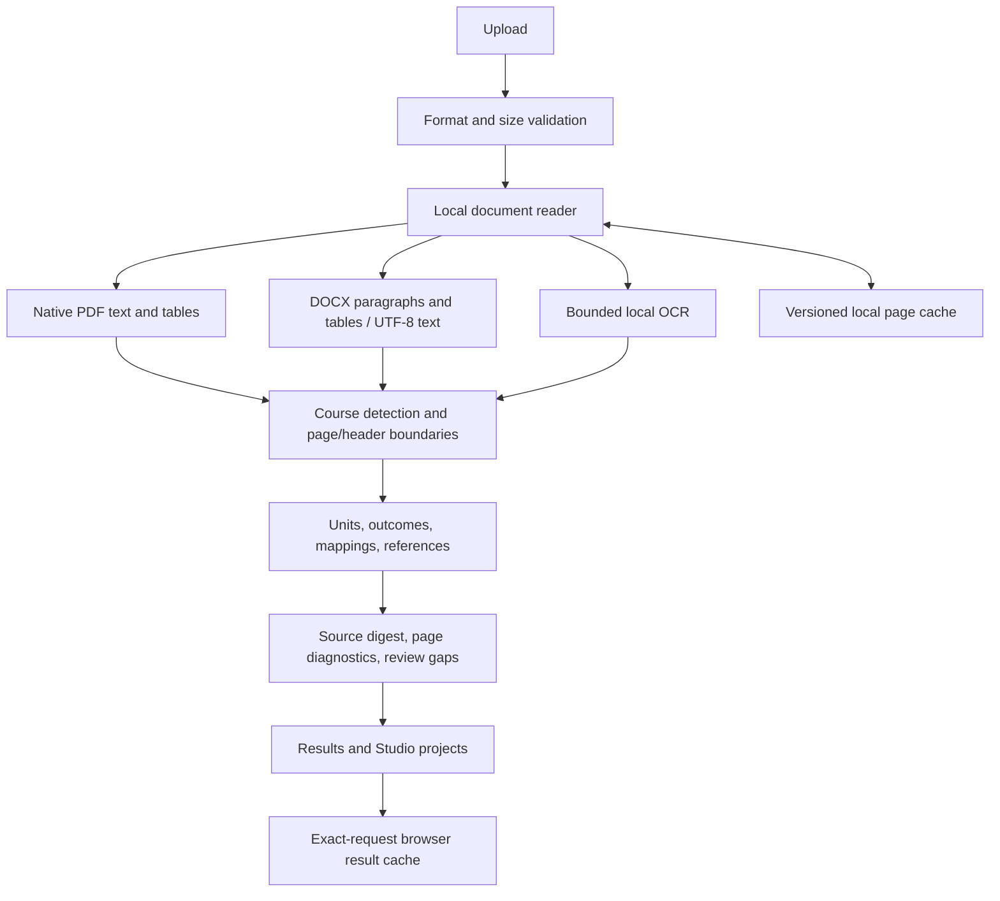

# Offline architecture and operating guide

Internet loss does not prevent new extraction **when the local Python server is running**. A cached hosted page alone cannot execute Python. It can reopen saved projects, replay prior matching extractions, run local assistant rules, and build study plans.

## Setup

Install dependencies while connected, then start the app:

```powershell
py -3.12 -m pip install -r requirements.txt
py -3.12 run.py
```

Open http://localhost:7823 and keep the server running. The offline readiness banner confirms browser shell caching. Select **Local deterministic** and save important analyses to Studio. Local extraction, audit/dossier generation, native-text book search, saved projects, study planning and source-based assistant replies require no internet.

Supported inputs: PDF, DOCX, UTF-8 TXT, Markdown, PNG, JPEG and TIFF. The existing `--pdf` option remains compatible; `--document` is an alias:

```powershell
py -3.12 sylex.py --document syllabus.docx
py -3.12 sylex.py --document syllabus.pdf --course CS101 --debug
```

## Local OCR

Install Tesseract and language data before disconnecting. The app finds Tesseract on PATH or in the standard Windows installation folder. This machine already has Tesseract; the generated scan tests exercise it directly. No Python OCR package or remote OCR service is needed. Optional environment settings, before starting the server:

```powershell
$env:SYLEX_TESSERACT = 'C:\Program Files\Tesseract-OCR\tesseract.exe'
$env:TESSDATA_PREFIX = 'C:\Program Files\Tesseract-OCR\tessdata'
$env:SYLEX_OCR_LANGUAGES = 'eng+tam'
```

Use installed languages only. `/api/status` reports availability without installation paths. Additional language recognition does not translate the parser's English section headings. Non-English body text is preserved; unusual headings may require course/page hints.

Sparse/corrupted text and large images trigger OCR consideration. Rendering is capped at ten million pixels. Each OCR subprocess has an 18-second timeout; the document shares an 80-second OCR budget. Split large scans. Incomplete reading is flagged. OCR text, particularly numbers and table mappings, always needs source review.

## Processing architecture



`document_ingest.py` owns adapters, OCR and source reports. `sylex.py` owns parsing. `offline_cache.py` stores reusable page content. `offline.js` handles browser recovery; `service-worker.js` caches public UI files only. `local-assistant.js` retrieves source excerpts and generates explicitly suggested study/question templates.

## Offline Book Agent

Book Explorer includes a deterministic research agent that works without an internet connection. It builds a reading path from the uploaded book's indexed PDF pages, aligns those pages with the active syllabus topics, reports coverage gaps, and keeps every recommendation linked to a page excerpt. It does not create unsupported summaries or silently claim that a missing topic is covered.

Book Finder also searches the browser's saved research shelf and books already attached to the active syllabus while offline. Live edition discovery, price/availability checks and new public-access links still require internet access. Save useful catalog findings to the research shelf before disconnecting.

## Correctness protections

- Catalog hints no longer truncate a course to its first page. Explicit end-page overrides remain supported.
- Printed headers isolate courses sharing a page. Shared-page tables are withheld when ownership is uncertain.
- Long courses continue past the old four-page limit. Courses with a printed title but no code retain an empty code.
- Dotted, spaced and numeric course codes are recognized. UNIT/MODULE/WEEK/SESSION/LESSON/TOPIC headings are anchored to line starts; prose such as “see unit 3” does not create units.
- Source SHA-256 and per-page reading diagnostics accompany results. Unstructured fallback text is flagged. Inferred Bloom labels remain distinct from printed labels.
- Cloud failure falls back to local extraction with accurate mode reporting. Failed cloud attempts are not cached as cloud success. Rules-only online fast paths are labeled local.
- Browser replay requires matching file bytes, filename and extraction settings. Invalid uploads and cancellation cannot become cached success. Storage failure does not prevent fresh extraction.
- Local assistant plans preserve topics and do not invent missing hours or credits. Source excerpts cite course-page ranges; generated practice questions and session allocations are labeled suggestions.
- Book Agent reading paths and syllabus matches cite indexed PDF pages. Optional online enhancement is disabled by default and is never required for local analysis.

## Storage and recovery

| Store | Contents | Limits |
| --- | --- | --- |
| `.sylex-cache/pages.sqlite3` | Page text, word coordinates, adapter tables, diagnostics | 32 entries; 30-day idle expiry; 96 MB payload budget; approximately 128 MB SQLite page cap |
| Browser offline results | Result JSON indexed by content/request fingerprint | Latest 40 requests; browser quota applies |
| Browser Studio | Saved analyses, notes, plans, source document Blobs | Until removed or site data is cleared |
| Service worker | Public HTML, JS, CSS | Versioned shell; no API responses, credentials or uploads |

The disk cache contains document content: protect the workspace accordingly. It is excluded from Git/deployment and disabled on Vercel. Set `SYLEX_CACHE_DIR=off` to disable it, or use a private directory. `POST /api/cache/clear` clears server caches and the local page cache. Browser site-data controls clear browser caches/projects; export important projects first. Project JSON does not include source bytes. Retain the original document separately; source reattachment verifies its SHA-256 when available.

Shell updates install atomically and wait for existing tabs to close. If an older interface remains visible, close SYLEX tabs and reopen. Hosted-site and localhost projects use separate browser origins; transfer project JSON and the matching source when needed.

## Remaining limits

No implementation can promise correct extraction from every syllabus. Blurred/handwritten scans, complex multi-column layouts, merged/image tables, unlabelled identities and nonstandard headings need review or hints. DOCX page references are logical sections separated by explicit page breaks, not rendered Word pagination. Convert legacy `.doc` files first. Uploads are limited to 50 MB, DOCX/XML and text content to 16 MB, and the primary reader to 1,500 pages.

Fresh catalog discovery, remote downloads and cloud reasoning require internet. Offline chat is deterministic retrieval/planning, not an installed general-purpose LLM. A stopped local server cannot process a new PDF through the cached page alone. Provider availability is outside the app's control.

## Verification

```powershell
py -3.12 -m unittest discover -s tests -v
node --test tests/api-client.test.cjs tests/chat-context.test.cjs tests/studio-core.test.cjs tests/local-assistant.test.cjs tests/offline-transport.test.cjs
```

Optional browser regression:

```powershell
py -3.12 -m pip install playwright
py -3.12 -m playwright install chromium
py -3.12 tests/browser_offline_check.py
```

This check uses an isolated profile and synthetic syllabus. It blocks external networking, extracts locally, disables browser networking, reloads the shell, restores a project/source, verifies exact-result replay and wrong-document rejection, then checks automatic fallback and mobile layouts. OCR tests use generated raster scans and skip explicitly if Tesseract is unavailable.
